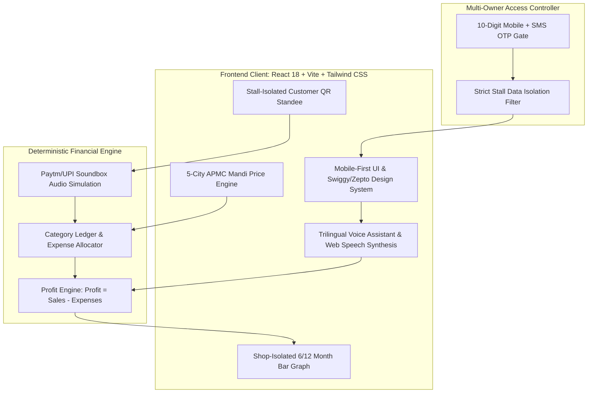

# KamaiMitra (कमाईमित्र / காமாய் மித்ரா)
## Product Requirement Document (PRD) & Final Project Architecture Summary

---

## 1. Executive Summary

**KamaiMitra** (*formerly Vendor AI*) is a mobile-first, voice-native financial intelligence and digital micro-ledger application designed specifically for India's 10+ million street vendors, pushcart merchants, and micro-retailers.

Unlike complex accounting software built for desktop accountants, KamaiMitra empowers local stall owners to calculate daily take-home profit accurately, eliminate supplier markups through live APMC mandi benchmarks, and capture contactless self-service customer payments using trade-isolated soundbox QR standees.

### Key Value Proposition
- **Deterministic Daily Profit Engine**: Instant calculation of `Profit = Total Sales - Total Expenses` with zero AI arithmetic hallucinations.
- **Trilingual Interactive Voice Assistant**: Real-time voice query and answering in **English, हिन्दी (Hindi), and தமிழ் (Tamil)** with text-to-speech feedback.
- **Strict Multi-Owner Stall Isolation**: Complete role and ledger segregation across 5 distinct vendor categories.
- **Multi-City APMC Mandi Benchmark**: Real-time wholesale rate comparisons across **Delhi, Mumbai, Kolkata, Chennai, and Bangalore**.
- **Customer Self-Service QR Hub**: Shop-specific Paytm/UPI soundbox simulation capturing customer name, phone number, and transaction amount.

---

## 2. Target Persona & User Profiles

| Profile Category | Representative Stall | Daily Sourcing Dynamics | Primary Operational Challenges |
| :--- | :--- | :--- | :--- |
| **Fruits & Fresh Veg** | *Radheshyam Fresh Vegetables & Fruits* | Perishable crates (Azadpur/Koyambedu/KR Market), tempo transport | 8-15% daily spoilage, fluctuating mandi prices, fast cash churn |
| **Street Food & Chaat** | *Gupta Chaat & Samosa Stall* | Potatoes, refined oil, maida, LPG cylinder, raw spices | High raw material markups, evening cash rush, multi-item customer orders |
| **Chai & Tea Kiosk** | *Sharma Ji Kulhad Chai* | Fresh milk packets, tea dust, sugar, kulhad clay cups, snacks | Thin margins per cup, high transaction volume, fast UPI payments |
| **Micro Kirana Store** | *Maa Durga Mini Kirana & Store* | FMCG cartons, grains, edible oil, salt, pulses | Wholesale distributor credit, inventory leakage, multi-SKU bookkeeping |
| **Flower & Pooja Stall** | *Shree Ganesh Pooja Bhandar & Flowers* | Flower garlands, loose blossoms, camphor, agarbatti | Extreme spoilage by nightfall, morning temple peak hours |

---

## 3. Product Architecture & System Design

---

## 4. Detailed Feature Specifications

### 4.1 Deterministic Profit Calculation Engine
- **Formula**: `Today's Profit = Today's Sales - Today's Expenses`
- **Validation**: Strict prevention of negative values, empty strings, and non-numeric inputs.
- **Guarantee**: Calculations are executed via pure client-side arithmetic (`Number(sales) - Number(expenses)`), strictly prohibiting generative AI approximations.
- **Dynamic Ledger Integration**: Adding cash sales or expense entries immediately updates **Today's Sales**, **Today's Expenses**, and **Today's Profit** in real-time.

---

### 4.2 Trilingual Smart Voice Assistant
- **Speech Recognition**: Uses browser-native Web Speech API with dynamically loaded locales:
  - English: `en-IN`
  - Hindi: `hi-IN`
  - Tamil: `ta-IN`
- **Natural Query Extraction**:
  - Detects spoken sales and expenses (e.g. *"Sales ₹2500 and expenses ₹900, calculate profit"*).
  - Answers current stall metrics on demand (*"What is my profit today?"*).
  - Logs voice-recorded purchases directly to the active shop ledger.
- **Speech Synthesis (Voice Answering)**: Uses `window.speechSynthesis` to read out structured financial answers in the vendor's chosen language.
- **1-Tap Language Changing Bar**: Seamlessly switches UI language, voice recognition locale, and text-to-speech dialect between English, Hindi, and Tamil with zero reload.
- **Resilient Fallback**: If browser speech recognition is unavailable or blocked, vendors can use **1-tap audio prompt chips** or the quick text bar.

---

### 4.3 Multi-Owner Security & Shop Isolation
- **Authentication**: Each stall is locked behind a registered 10-digit mobile number with simulated SMS OTP generation.
- **Data Boundary**: A vendor logging into *Shree Ganesh Pooja Bhandar & Flowers* can only view and manage flower stall metrics. Cross-shop tabs, graphs, and revenues are strictly excluded to protect privacy.
- **Customer Access Protection**: Customer self-service checkouts cannot view or modify owner financial ledgers.

---

### 4.4 5-City APMC Mandi Price Benchmark
- **Coverage**:
  1. 🏛️ **Delhi**: Azadpur APMC Mandi (National base modal rate = 1.0)
  2. 🌊 **Mumbai**: Vashi APMC, Navi Mumbai (+13% transport premium)
  3. 🌿 **Kolkata**: Kolay Market & Mechua (−9% farm proximity discount)
  4. ☀️ **Chennai**: Koyambedu Wholesale Complex (+7% South India logistics)
  5. 🌳 **Bangalore**: Yeshwanthpur APMC & KR Market (+5% Karnataka farm auctions)
- **Arbitrage Detection**: Highlights items where supplier markup exceeds official APMC modal rates, calculating daily leakage and projected monthly savings.
- **1-Click Ledger Logging**: Vendors can log sourced items directly from the mandi price table into their day's expenses.

---

### 4.5 Shop-Isolated Monthly Sales & Profit Analytics
- **Visualization**: Dual-bar monthly trend graph (slate bar for sales, shop-themed bar for profit).
- **Scope**: Features **6-Month** and **12-Month** historical views tailored exclusively to the active shop.
- **Live Sync**: Current month metrics dynamically update whenever customer self-payments or manual entries are recorded.

---

### 4.6 Customer Self-Service QR Hub & Soundbox Simulator
- **Standee Hub**: Each stall generates its own customized QR standee modal.
- **Customer Metadata Capture**: Records customer name, 10-digit phone number, purchased items, and total amount.
- **Soundbox Audio Feedback**: Plays authentic payment announcements (e.g. *"Paytm par ₹108 prapt hue"* / *"Cash payment recorded"*).
- **Ledger Attribution**: Payments are credited strictly to the shop matching the customer's QR checkout session.

---

## 5. UI/UX Design System

| Element | Specification | Rationale |
| :--- | :--- | :--- |
| **Theme Palette** | Deep Teal (`#062E38`), Mint Green (`#10B981`), Warm Gold (`#F59E0B`), Clean White (`#FFFFFF`) | Trustworthy fintech aesthetic inspired by modern Indian digital banking |
| **Typography** | Inter (English), Noto Sans Devanagari (Hindi), Noto Sans Tamil (Tamil) | Optimal legibility on low-cost Android mobile screens |
| **Touch Targets** | Minimum 48px height across all buttons, inputs, and tabs | Designed for one-handed operation by vendors with busy stalls |
| **Splash Screen** | Custom `KamaiMitraLogo` with golden prosperity spark and 9-note acoustic melody chime | Welcoming, premium feel without annoying robotic voice prompts |

---

## 6. Technical Stack & Dependencies

- **Frontend Core**: React 18.3+, Vite 6.4+
- **Styling**: Tailwind CSS 3.4+ with custom animation utilities (`animate-voice-pulse`, `animate-wave-1...5`)
- **Icons**: Lucide React
- **Audio Engine**: Web Audio API (`AudioContext`, `BiquadFilterNode`, `OscillatorNode`)
- **Speech Engine**: Web Speech API (`webkitSpeechRecognition`, `SpeechSynthesisUtterance`)
- **Storage**: Browser `localStorage` for language preference and session tokens
- **Version Control**: Git / GitHub (`github.com/mmonikapvm2005-coder/vendor-ai`)

---

## 7. Future Roadmap & Production Scaling

1. **Backend Integration**: Replace simulated SMS OTP with Twilio / Gupshup SMS gateway and PostgreSQL ledger storage.
2. **PWA (Progressive Web App)**: Add offline service workers so vendors can record sales without cellular data in remote bazaars.
3. **Hardware Soundbox Bluetooth Integration**: Pair directly with physical 4G Bluetooth soundbox speakers.
4. **Micro-Credit & Pradhan Mantri SVANidhi Loan Scoring**: Generate verifiable PDF profit certificates to help vendors qualify for formal bank loans.
